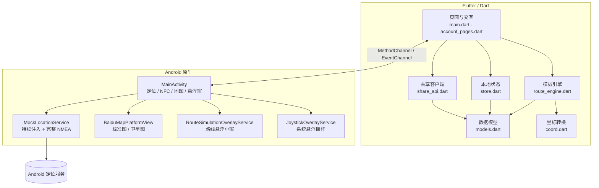

<div align="center">

# SchoolRunToolBox

**校园跑路线模拟与 NFC 调试工具箱**

Flutter + Android 原生混合实现：在百度地图上绘制路线、注入模拟定位、
读取 / 模拟 NFC，并通过可选的共享服务器分发路线、NFC 配置与模拟参数。

[](https://flutter.dev)
[](https://dart.dev)
[](https://developer.android.com)
[](#测试)
[](pubspec.yaml)

</div>

> [!WARNING]
> 本项目仅用于**合法合规的开发、调试、学习与研究**（Android 模拟定位、NFC、轨迹算法等工程实践）。
> 请勿用于作弊、绕过平台规则、冒充第三方应用或其他违法违规用途。
> 使用本项目产生的一切后果由使用者自行承担，详见[免责声明](#免责声明)。

## 目录

- [项目简介](#项目简介)
- [功能特性](#功能特性)
- [工作原理](#工作原理)
- [环境要求](#环境要求)
- [快速开始](#快速开始)
- [首次使用](#首次使用)
- [项目结构](#项目结构)
- [配置项说明](#配置项说明)
- [坐标系约定](#坐标系约定)
- [共享服务器接口](#共享服务器接口)
- [测试](#测试)
- [常见问题](#常见问题)
- [数据与隐私](#数据与隐私)
- [第三方组件](#第三方组件)
- [免责声明](#免责声明)

## 项目简介

SchoolRunToolBox（应用名 **RunToolBox**）是一个 Android 端的路线与 NFC 工具箱：

- 在百度地图上取点、绘制、编辑校园跑路线；
- 用前台服务持续向系统注入模拟定位，并生成完整的 NMEA / 卫星状态；
- 提供退出应用后仍可操作的路线悬浮小窗与系统悬浮摇杆；
- 读取与模拟 NFC 标签；
- 可选地连接自建共享服务器，分发路线、NFC 配置、模拟参数与使用提示。

项目没有引入第三方 Flutter 包，Dart 侧只依赖 Flutter SDK；地图、定位注入、
NFC、悬浮窗等能力全部通过 `MethodChannel` / `EventChannel` 由 Android 原生层实现。

## 功能特性

### 地图与路线

- 百度地图标准图 / 卫星图切换、POI 搜索、逆地理编码、点击 / 长按取点、当前位置标记。
- 路线编辑：撤销 / 重做、闭合、自动加点、自动减点（保护关键点）、
  防直角圆角、拖拽顶点、在路线附近插入顶点、删除选中顶点。
- 路线库：保存 / 重命名 / 删除，导入导出 JSON（同时写入 BD-09 与 WGS-84 两套坐标）。
- 按固定间隔录制移动路线（默认 3 秒 / 点，间隔可改）。

### 定位模拟

- **速度 / 步频**两种模式；步频按 0.8 m 平均步长换算速度。
- 速度随机游走与平滑、自然轨迹米制横向偏移、海拔 / 身高 / 概率波动。
- 循环圈数、暂停 / 继续、完成提示、隐私路线遮罩。
- 真实步数联动（按「步数/米」与 link 比例累计后推进一帧）。
- 前台服务持续注入：默认 200 ms 间隔 + `PARTIAL_WAKE_LOCK`，
  暂停、完成、切后台、熄屏都不会中断；目标应用提交成绩时仍能读到终点位置。
- 完整 NMEA（GPRMC / GPGGA / GPGSV / GPGSA / GPGVTG）与高精度元数据
  （accuracy / verticalAccuracy / speedAccuracy / bearingAccuracy）。
- 可配置卫星数（1–12）、信号质量（0–2）、HDOP、注入间隔（100–2000 ms）、
  网络定位辅助信号。

### 悬浮控件

- 离开本应用后自动浮出路线悬浮小窗（百度地图 + 暂停 / 继续），可拖动、缩放，
  回到本应用自动收起。
- 系统悬浮摇杆：步 / 跑 / 骑三档速度，可在其它应用上方控制模拟位置。

### NFC

- 前台读取（reader mode）：自动识别 URL、`android.com:pkg` 应用记录与文本记录，
  读取后自动保存为当前配置。
- 模拟 NFC：未开始模拟时登记，开始模拟后自动派发；运行中立即派发。
- 派发三级回退：NDEF → 带包名 VIEW Intent → 浏览器，并返回三档结果提示。
- 本地配置增删改查，共享 NFC 上传 / 搜索 / 下载。

### 共享服务器与账号

- 共享路线：列表、下载保存、下载并模拟、隐私路线直接模拟（不落盘）。
- 共享模拟配置：搜索、拉取、应用、上传。
- 使用提示：浏览、搜索、HTML 转纯文本展示、编辑 / 发布 / 删除、Word 导入。
- 内部账号：登录 / 资料刷新 / 退出，使用稳定的 `ANDROID_ID` 作为设备标识。
- 启动公告（`/api/client-config`）、QQ 群与 B 站入口。

### 其他

- 调试算法实验室：步频一致性实验、调试日志开关等。
- 历史记录（默认保留 7 天，可调）、设置持久化、用户协议与免责声明。

## 工作原理



原生层通过 `schoolrun/platform`（方法调用）、`schoolrun/location`、
`schoolrun/nfc`、`schoolrun/sensors`、`schoolrun/storage` 与 Dart 侧通信。

## 环境要求

| 组件 | 版本 / 说明 |
| --- | --- |
| Flutter | 3.41.6 已验证（Dart 3.11.4） |
| Android SDK | `compileSdk` / `targetSdk` 36，`minSdk` 24（Android 7.0+） |
| JDK | 17（`sourceCompatibility` / `targetCompatibility`） |
| Android Gradle Plugin | 8.9.1 |
| Kotlin | 2.1.0 |
| 百度地图 Android SDK | 7.6.5，已放在 `android/app/libs/` |
| 设备 ABI | 百度原生库仅提供 **arm64-v8a**，请使用 64 位 ARM 真机 |

> 模拟器通常缺少 arm64 原生库与地图服务，建议使用真机调试。

## 快速开始

### 1. 克隆并安装依赖

```bash
git clone https://github.com/YaoZA233/SchoolRunToolBox.git
cd SchoolRunToolBox
flutter pub get
```

### 2. 配置 Android SDK 与百度地图 AK

复制 `android/local.properties.example` 为 `android/local.properties`，填写本机路径与 AK：

```properties
sdk.dir=D:\\Android\\Sdk
flutter.sdk=D:\\flutter
MAPS_API_KEY=你的百度地图 Android SDK AK
```

> `android/local.properties` 已被 `.gitignore` 排除，不会提交。
> 构建脚本也会读取同名环境变量 `MAPS_API_KEY`。

百度地图 AK 需在[百度地图开放平台](https://lbsyun.baidu.com/)创建，应用类型选
**Android SDK**，包名填 `com.campusruntoolbox.flutter`，并填入签名 SHA1。

调试签名的 SHA1 可用下面的命令查看：

```powershell
keytool -list -v `
  -keystore "$env:USERPROFILE\.android\debug.keystore" `
  -alias androiddebugkey -storepass android -keypass android
```

> 未配置 AK 时应用仍可启动，路线、模拟定位、NFC 等功能可用，
> 但百度地图底图会显示空白，Logcat 中会出现 `Authentication Error`。

### 3. 分析、测试与运行

```bash
flutter analyze
flutter test
flutter run
```

### 4. 构建 APK

```bash
flutter build apk --release
# 产物：build/app/outputs/flutter-apk/app-release.apk
```

### 5. 配置 release 签名（可选）

复制 `android/key.properties.example` 为 `android/key.properties` 并填写：

```properties
storeFile=app/runtoolbox-release.jks
keyAlias=your-key-alias
storePassword=your-store-password
keyPassword=your-key-password
```

- `storeFile` 相对 `android/` 目录解析。
- 未提供有效签名时，release 构建会回退到 debug 签名。
- `key.properties`、`*.jks`、`*.keystore` 均已被 `.gitignore` 排除，**请勿提交**。

## 首次使用

1. 打开应用并阅读、同意《用户协议与免责声明》。
2. 打开系统 **开发者选项 → 选择模拟位置信息应用 → RunToolBox**。
   应用内「我的 → 模拟定位权限」可直接查看状态并跳转。
3. 授予定位、通知、悬浮窗权限（悬浮窗用于路线小窗与摇杆）。
4. 在「我的 → 共享中心」填写共享服务器地址（可选），例如 `http://10.0.2.2:8000/`。
   浏览、下载、上传路线 / NFC 不需要登录；编辑使用提示需要内部账号。

### 推荐使用流程

1. 地图工作台搜索或取点 → 「用地图点绘制路线」→ 调整路线 → 保存。
2. 在路线库点击播放 → 设置速度 / 循环 → 开始模拟。
3. 需要进入目标应用时：先在 NFC 页填好 URL 与包名（或读取真实标签），点「模拟 NFC」登记；
   开始模拟后会自动派发。也可在模拟运行中直接点「模拟 NFC」。
4. 离开本应用后悬浮小窗自动出现，可暂停 / 继续。完成后保持终点位置，
   确认目标应用提交成功再结束模拟。

## 项目结构

```text
SchoolRunToolBox/
├── lib/
│   ├── main.dart                  # 应用入口、页面与交互
│   ├── account_pages.dart         # 内部账号登录 / 资料页
│   ├── models.dart                # 路线 / 模拟 / NFC / 共享 / 账号模型
│   ├── route_engine.dart          # 模拟引擎与路线编辑算法
│   ├── coord.dart                 # WGS-84 / GCJ-02 / BD-09 转换
│   ├── store.dart                 # 本地快照、设备 ID、登录态、历史
│   └── share_api.dart             # 共享服务器 HTTP 客户端
├── test/
│   ├── coord_test.dart            # 坐标转换 / 步数联动 / 结束条件
│   └── route_engine_test.dart     # 路线距离 / 插点 / 模拟推进
├── android/
│   ├── app/src/main/kotlin/com/campusruntoolbox/flutter/
│   │   ├── MainActivity.kt        # 平台通道：定位、NFC、地图、悬浮窗、文件、传感器
│   │   ├── MockLocationService.kt # 模拟定位前台服务（持续注入 + WakeLock）
│   │   ├── CompleteNmea.kt        # 完整 NMEA 语句生成
│   │   ├── CoordinateConverter.kt # Kotlin 侧 BD-09 / WGS-84 转换
│   │   ├── BaiduMapPlatformView.kt# 百度地图 PlatformView
│   │   ├── RouteSimulationOverlayService.kt # 路线悬浮小窗
│   │   ├── JoystickOverlayService.kt        # 系统悬浮摇杆
│   │   └── SchoolRunApplication.kt          # 初始化百度 SDK
│   ├── app/libs/                  # 百度地图 SDK（jar + arm64-v8a）
│   ├── app/build.gradle
│   ├── local.properties.example
│   └── key.properties.example
├── docs/
│   └── coordinate-system.md       # 坐标系约定与偏差修复记录
├── analysis_options.yaml
├── pubspec.yaml
└── README.md
```

## 配置项说明

| 文件 | 作用 | 是否提交 |
| --- | --- | --- |
| `android/local.properties` | 本机 SDK 路径、`MAPS_API_KEY` | 否 |
| `android/key.properties` | release 签名信息 | 否 |
| `android/*.jks` / `*.keystore` | 签名密钥库 | 否 |
| `android/local.properties.example` | 本机配置模板 | 是 |
| `android/key.properties.example` | 签名配置模板 | 是 |
| `pubspec.lock` | 锁定依赖版本（应用项目应提交） | 是 |

其他常用环境变量：`MAPS_API_KEY`（同 `local.properties`）、
`FLUTTER_STORAGE_BASE_URL`（Gradle 依赖镜像，默认 `https://storage.googleapis.com`）。

## 坐标系约定

- Dart 侧、本地快照、路线编辑与百度地图绘制统一使用 **BD-09**，绘制时直接透传。
- 仅在向系统注入模拟定位、生成 NMEA 时转换为 **WGS-84**。
- 上传共享后端时同时提交 BD-09 与 WGS-84 两套坐标，便于其它端直接读取。
- `wgs84ToBd09()` 只用于「输入只有 WGS-84」的导入场景，不要接回显示链路。

完整说明、历史 Bug 与实测偏移量见 [`docs/coordinate-system.md`](docs/coordinate-system.md)。

## 共享服务器接口

共享服务器是可选的，不配置也不影响本地功能。客户端按以下约定访问
`<baseUrl>/api/...`，列表响应包装为 `{items:[...]}`，详情响应包装为 `{data:{...}}`。

<details>
<summary>展开接口一览</summary>

| 方法 | 路径 | 说明 | 令牌 |
| --- | --- | --- | --- |
| GET | `/api/client-config` | 启动公告、QQ 群、B 站入口 | 否 |
| POST | `/api/auth/login` | 内部账号登录 | 否 |
| GET | `/api/auth/me` | 当前账号资料 | 是 |
| GET | `/api/shared/routes` | 共享路线列表 | 否 |
| GET | `/api/shared/routes/{id}` | 共享路线详情 | 否 |
| POST | `/api/shared/routes` | 上传路线（BD-09 + WGS-84） | 可选 |
| GET | `/api/shared/nfc` | 共享 NFC 列表 | 否 |
| POST | `/api/shared/nfc` | 上传 NFC 配置 | 否 |
| GET | `/api/shared/simulation-configs?q=` | 搜索共享模拟配置 | 否 |
| GET | `/api/shared/simulation-configs/{id}` | 模拟配置详情 | 否 |
| POST | `/api/shared/simulation-configs` | 上传模拟配置 | 否 |
| GET | `/api/tips?q=&page=&pageSize=` | 使用提示列表 | 否 |
| GET | `/api/tips/{id}` | 提示详情 | 否 |
| POST | `/api/tips` | 新建提示 | 是 |
| PUT | `/api/tips/{id}` | 更新提示 | 是 |
| DELETE | `/api/tips/{id}` | 删除提示 | 是 |
| POST | `/api/tips/import-word` | 导入 Word 文档 | 可选 |

</details>

应用允许明文 HTTP（`usesCleartextTraffic="true"`），便于在局域网内直连自建服务；
正式部署建议使用 HTTPS。

## 测试

```bash
flutter analyze   # 静态分析：无 issue
flutter test      # 单元测试：11 个用例全部通过
```

测试覆盖：

- BD-09 / WGS-84 往返转换误差；
- 路线点 JSON 双坐标兼容与仅 WGS 反算；
- 路线距离、按顺序插点；
- 模拟速度、循环结束条件；
- 真实步数联动阈值。

## 常见问题

<details>
<summary><b>地图底图空白 / Logcat 出现 Authentication Error</b></summary>

百度地图 AK 未配置，或 AK 绑定的包名 / SHA1 与当前签名不一致。
检查 `android/local.properties` 中的 `MAPS_API_KEY`，并在百度地图开放平台
核对包名 `com.campusruntoolbox.flutter` 与签名 SHA1。
</details>

<details>
<summary><b>模拟定位不生效</b></summary>

依次检查：

1. 系统「开发者选项 → 选择模拟位置信息应用」是否选中 **RunToolBox**；
2. 是否授予「精确位置」权限；
3. 模拟服务是否被系统或厂商电池策略杀死（可在通知栏看到前台服务）；
4. 部分系统需要在应用信息中允许「后台弹出界面 / 自启动」。
</details>

<details>
<summary><b>悬浮小窗或摇杆不显示</b></summary>

需要「显示在其他应用上层」权限；MIUI / EMUI / ColorOS 等还需在系统设置中
单独允许后台悬浮窗与自启动。回到本应用时路线小窗会自动收起，属正常行为。
</details>

<details>
<summary><b>共享中心请求失败</b></summary>

- 地址需带协议，例如 `http://192.168.1.10:8000/`；
- 手机与服务器需在同一网络，或在服务器侧放行端口；
- 服务端需实现[上表](#共享服务器接口)中的接口；
- 应用已允许明文 HTTP，若使用 HTTPS 请确保证书受系统信任。
</details>

<details>
<summary><b>NFC 读不到标签</b></summary>

确认设备支持 NFC 且已在系统设置中开启；贴卡时保持屏幕常亮并停留在 NFC 页；
部分加密卡或非 NDEF 标签无法被前台 reader mode 解析。
</details>

<details>
<summary><b>构建失败</b></summary>

- 确认 JDK 17、Android SDK 36 已安装，`flutter doctor` 无红色项；
- 先执行 `flutter pub get`；
- 签名配置缺失不影响 `flutter run`，release 会回退到 debug 签名；
- 首次构建需要下载 Gradle 依赖，网络受限时可配置 `FLUTTER_STORAGE_BASE_URL` 镜像。
</details>

<details>
<summary><b>安装后在模拟器上地图不显示 / 闪退</b></summary>

百度地图原生库仅包含 arm64-v8a，请使用 64 位 ARM 真机；x86_64 模拟器通常无法加载。
</details>

## 数据与隐私

- 路线、设置、历史、NFC 配置默认只保存在本机（`SharedPreferences`），不使用云端同步。
- 应用不包含统计、广告或第三方追踪 SDK。
- 只有当你主动配置并访问「共享服务器」时，相关数据才会发送到你指定的服务端。
- 设备标识使用稳定的 `ANDROID_ID`，仅用于内部账号的设备绑定。

## 第三方组件

| 组件 | 说明 |
| --- | --- |
| [百度地图 Android SDK](https://lbsyun.baidu.com/) 7.6.5 | 地图展示、取点、POI、定位；版权归北京百度网讯科技有限公司，遵循百度地图开放平台服务条款 |
| Flutter / Material Icons | UI 框架与图标，遵循各自开源许可 |

仓库中的 `android/app/libs/` 仅用于本地构建，不代表对第三方 SDK 的再授权。

## 免责声明

本项目按「现状」提供，不附带任何明示或暗示的担保。作者不对使用本项目造成的
任何直接或间接损失负责。

本项目仅用于合法合规的开发、调试、学习与研究。请勿将其用于：

- 作弊或伪造校园跑 / 体育成绩；
- 绕过任何平台、应用或服务的使用规则；
- 冒充第三方应用、侵犯他人权益或其他违法违规用途。

如果你所在的学校或组织禁止此类工具，请遵守其规定。使用即表示你已理解并同意上述条款。

## 许可证

本仓库目前**未附带开源许可证**，代码版权归作者所有。如需引用、分发或用于商业用途，
请先联系作者获得授权。第三方组件遵循其各自许可。
